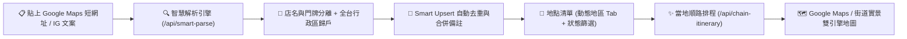

# 🧭 Wayfinder 智慧旅遊景點秒存與順路導航 PWA — 開發與實戰修正全紀錄

> [!abstract] 專案核心願景
> 解決平時滑 IG、Threads、Google Maps 看到想去的店「隨手複製卻散落各處、重複收藏」，以及抵達當地後「不知道怎麼把想去的店串成順路行程」的旅遊痛點。
> - **GitHub 儲存庫**：[andrewdu0805/wayfinder-travel](https://github.com/andrewdu0805/wayfinder-travel)
> - **Vercel 線上版 / PWA**：[https://wayfinder-travel-kohl.vercel.app](https://wayfinder-travel-kohl.vercel.app)

---

## 🏗️ 1. 系統架構與技術選型

- **前端框架**：[[Next.js]] 16.4 (App Router + Turbopack)、[[React]] 19、[[Tailwind CSS]] v4
- **資料儲存與同步**：
  - **本機優先（Local-First）**：使用瀏覽器 `localStorage` 即時持久化，離線或重整頁面皆不遺失。
  - **雲端備份**：支援 [[Supabase]] 雲端資料庫一鍵雙向同步與完整 JSON 匯出/匯入。
- **智慧解析與排程引擎**：
  - **AI 意圖與多店擷取**：[[Gemini API]] (`gemini-2.5-flash`) + 本地語義規則雙軌解析。
  - **門牌與行政區正規化**：內建台灣 368 鄉鎮市區對照表與門牌分離器。
  - **雙引擎互動地圖**：官方 [[Google Maps API]] (JavaScript SDK + Places API) ＋ **[[Leaflet]] (CartoDB Voyager 開放街道實景圖)** 無縫切換。

---

## 🛠️ 2. 實際使用過程中的關鍵修正（Lessons Learned）

在完成初版原型並實際安裝到手機 **[[PWA]]** 操作後，透過真實使用情境發現並解決了以下 5 大關鍵 UX 與技術問題：

### ① 手機 PWA 空間利用率與觸控體驗重構
> [!tip] 設計原則：小螢幕寸土寸金，把每一像素留給核心內容
- **問題**：初版頂部有大面積的介紹橫幅、說明文字直接攤開佔位，「+快速新增地點」獨立佔據一整排，且設定視窗在手機上字體過小、分頁標籤（`🔑 API金鑰`）被擠出畫面。
- **修正方案**：
  1. **操作列極簡合併**：將原本分開的按鈕濃縮為單行三鍵 **`[➕ 新增]`**、**`[📋 貼上]`**、**`[📂 匯入]`**。
  2. **說明框收納化**：將清單與排程頁面的冗長提示改為標題旁的 **`ⓘ`** 圖示，點擊才彈出說明框。
  3. **卡片去蕪存菁**：移除列表上較少用到的「★ 評分星星」，將空間讓給直覺的 **`[🗑️ 刪除]`** 鍵、**`[📍 地圖]`** 與分類下拉選單，並把地區標籤與地圖按鈕移至店名上方，讓長店名不再被折行截斷。
  4. **設定視窗滿版大字體**：採用手機 Bottom-Sheet 滿版設計、加大輸入框與字級，並將頂部切換鈕改為等寬雙欄 Grid。

---

### ② Google Maps 分享連結解析：「地址變店名」與「誤判高雄鹽埕區」
> [!bug] 實戰踩坑：Google Maps 短網址展開後的字串陷阱
- **問題現象**：
  - 貼上「王家燻羊肉」或「阿蓮牛肉湯」的 Google Maps 連結後，存入的店名竟變成 `臺南市新化區豐榮里大智路37號 阿蓮牛肉湯`，且下方地區竟然標示為 `(高雄市・鹽埕區)`。
- **根本原因**：
  1. Google Maps 短網址（`maps.app.goo.gl/...`）重新導向展開後的網址結構為 `/place/臺南市新化區豐榮里大智路37號+阿蓮牛肉湯/@23.03...`，地址與店名被 `+` 串在同一個區段。
  2. 當後端未能獨立拆出 `addressHint` 時，舊邏輯自動在字串前方冠上預設起點 `台灣高雄市鹽埕區`，導致正規表達式從頭匹配時，優先抓到了最前面的「高雄市・鹽埕區」。
- **修正方案**（見 `lib/geo-utils.ts` 與 `app/api/smart-parse/route.ts`）：
  1. 實作 **`separateNameAndAddress()`**：利用台灣與日本門牌正則（識別郵遞區號、縣市、區市鎮鄉、里鄰、路街段巷弄號），自動將「完整門牌地址」與「純店名」精準剝離。
  2. 建立 **`DISTRICT_TO_CITY_MAP`**：涵蓋台南 37 區（新化區、龍崎區等）、高雄 38 區與全台鄉鎮市區對照表，搭配展開網址中的 `@lat,lng` GPS 座標邊界檢查，徹底杜絕誤判。
  3. **既有髒資料自動自癒（Self-Healing）**：在 `PlacesContext.tsx` 讀取 `localStorage` 時加入 `sanitizePlaceRecord`，不需手動刪重加，重整頁面即自動修復手機裡已存的項目。

---

### ③ 互動式地圖「一片黑」問題與雙引擎實景架構
> [!warning] 環境變數前綴與無金鑰 Fallback 的視覺體驗
- **問題現象**：地圖區域顯示全黑背景與暗色網格線（「整個黑的也沒有意義」），且上方 `[🗺️ Google Maps]` 按鈕無法點選。
- **根本原因**：
  1. 在 Next.js 中，未加 `NEXT_PUBLIC_` 前綴的環境變數僅存在於 Server 端，前端瀏覽器讀不到 `GOOGLE_MAPS_API_KEY`。
  2. 未載入 Google Maps 時的 Fallback 採用深黑底色（`#0d1620`）的向量雷達圖，缺乏真實道路與街廓資訊。
- **修正方案**（見 `next.config.ts` 與 `components/RouteVisualizerMap.tsx`）：
  1. 在 `next.config.ts` 的 `env` 區塊將 `process.env.GOOGLE_MAPS_API_KEY` 自動映射至前端 `NEXT_PUBLIC_GOOGLE_MAPS_API_KEY`。
  2. **徹底移除黑底雷達圖**，導入 **[[Leaflet]] + CartoDB Voyager 開放街道實景圖**作為免 API Key 的預設高解析度彩色街景圖，清楚顯示台灣/日本真實道路、中文路名、彩色編號站牌（① ② ③）與路線軌跡。
  3. 在地圖頂部提供 **`[🔑 貼上 Key 啟用 Google]`** 快捷鍵，支援隨時在 **`[🗺️ Google Maps]`** 與 **`[🌍 街道實景圖]`** 間一鍵切換。

---

### ④ 電腦版網頁 vs. 手機 PWA 的金鑰跨裝置秒同步
> [!info] 瀏覽器沙盒隔離（Storage Isolation）的優雅解法
- **問題現象**：在電腦版網頁已經填好 `GOOGLE_MAPS_API_KEY`，但打開手機上的 PWA 卻發現金鑰欄位是空的。
- **根本原因**：`localStorage` 屬於各裝置瀏覽器本機獨立沙盒，電腦瀏覽器的本機儲存不會自動同步到手機 PWA。
- **修正方案**（見 `components/CategoryAndSettingsModal.tsx`）：
  - 在電腦版設定頁新增 **`[📱 產生 QR Code 讓手機掃描]`** 與 **`[📋 複製同步連結]`** 功能。
  - 將金鑰打包編碼為 `/?sync_keys=...` 參數，手機相機一掃打開網址，`PlacesContext` 立即自動解碼寫入手機 `localStorage` 並自動抹除網址列參數，免去在手機小鍵盤輸入長金鑰的痛苦。

---

### ⑤ 動態多地區擴充與數量精準統計
> [!success] 資料驅動的 UI 狀態管理
- **問題現象**：
  1. 原本只有預設 4 個地區按鈕，新增其他縣市（如屏東、宜蘭、京都）時不知道怎麼放進去。
  2. 把「台北市」的地點全部刪光後，地區按鈕上卻還標著 `台北市 (3)`，或是重新整理後預設範例又跑回來。
- **根本原因**：
  - 舊版在篩選陣列長度為 0 時，Fallback 回傳了預設數量；且 `localStorage` 讀取時判斷了 `parsed.length > 0`，導致使用者刪光地點變成空陣列 `[]` 時被系統誤判為未初始化而重新載入預設資料。
- **修正方案**：
  1. **動態地區標籤列**：根據目前清單中的所有地點，自動聚合產生地區按鈕並精確計算各區筆數，還支援在新增時直接透過 **`[➕ 新地區]`** 手動指定任何國內外城市。
  2. **嚴格尊重使用者增刪紀錄**：修正為 `rawPlaces !== null` 即以使用者本機資料為準，即使刪到 0 筆也不會強制塞回預設資料；未來每次部署更新程式碼時，使用者在手機裡的收藏紀錄 100% 完整保留。

---

## 📂 3. 關鍵檔案索引

| 模組 | 檔案路徑 | 核心職責 |
| :--- | :--- | :--- |
| **全域狀態與同步** | `context/PlacesContext.tsx` | 本機 `localStorage` 持久化、既有資料自動修復、URL `sync_keys` 掃碼同步、Supabase 雲端同步 |
| **智慧輸入解析 API** | `app/api/smart-parse/route.ts` | Google Maps 短網址展開、HTML `<title>` / OG 擷取、Gemini 意圖分類、Google Places 補全 |
| **地理與門牌工具** | `lib/geo-utils.ts` | `separateNameAndAddress` 店名地址分離、`extractRegionFromAddress` 368 鄉鎮市區歸戶、Haversine 距離計算 |
| **動態順路排程 API** | `app/api/chain-itinerary/route.ts` | 依出發時間、停留時長、營業狀態與返程終點（高鐵/火車/飯店）自動串聯順路動線 |
| **雙引擎互動地圖** | `components/RouteVisualizerMap.tsx` | Google Maps JS SDK 與 Leaflet 開放街道實景圖雙引擎切換、路線 Polyline 與站點編號繪製 |
| **極簡快速新增列** | `components/SmartQuickAddBar.tsx` | 單列整合 `➕新增 / 📋貼上 / 📂匯入`、新地區指定、新增後原地修改分類與狀態卡片 |
| **設定與掃碼同步** | `components/CategoryAndSettingsModal.tsx` | 彈性子分類與預設停留時間管理、API Key 設定、電腦產生 QR Code 供手機掃碼同步 |

---

## 💡 4. 下一步可延伸方向（Future Ideas）
- [ ] **多人共編旅遊清單**：利用 Supabase Realtime 讓旅伴共用同一個 Trip ID 即時同步新增景點。
- [ ] **天氣與雨備模式一鍵切換**：整合氣象 API，下雨時自動將「自然步道/戶外」降權，優先排入「展館/室內咖啡廳」。
- [ ] **Apple 捷徑 / Android 分享選單深度整合**：在手機 Google Maps 按「分享 ➔ Wayfinder」直接背景秒存。
